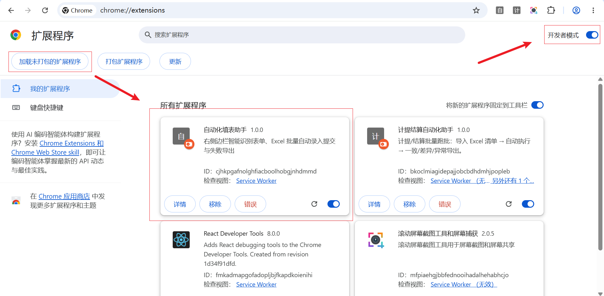
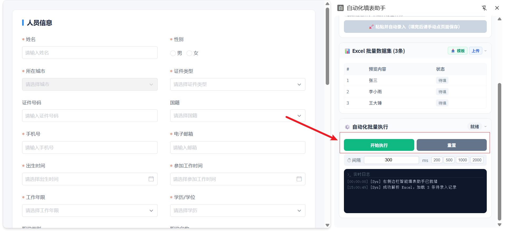
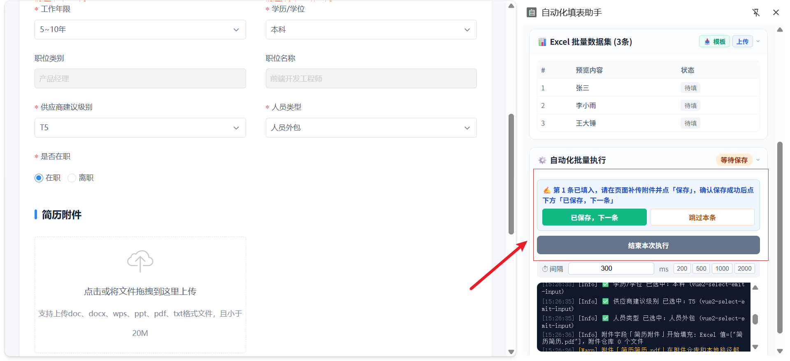
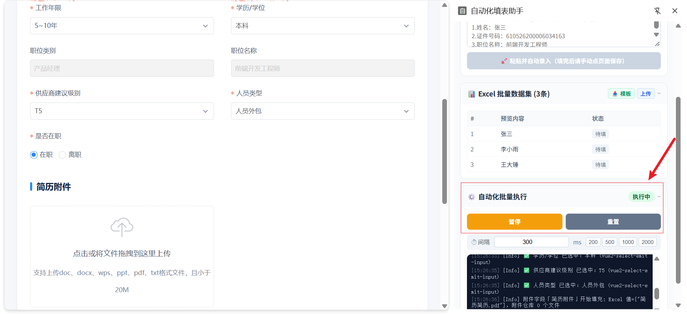
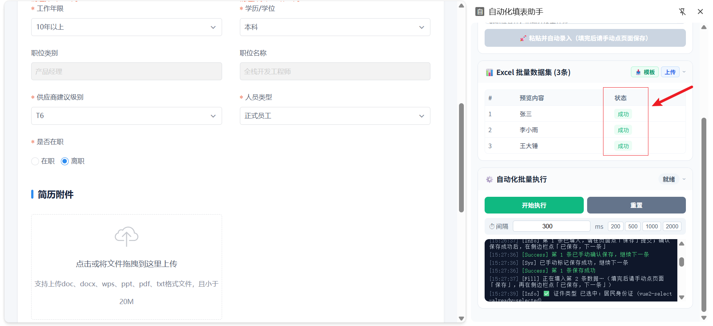

# 智能填表助手 · 使用说明

把 Excel 里的一行行数据，或一段粘贴的文本，自动填进网页表单。**保存永远由你手动点**，扩展只负责填。不用懂技术，照下面做就行。

## 一、安装扩展

1. 解压收到的压缩包，里面有一个 `dist` 文件夹。
2. 浏览器地址栏输入 `chrome://extensions` 回车（或：右上角「⋮」→「扩展程序」→「管理扩展程序」）。
3. 打开右上角「开发者模式」，点左上角「加载已解压的扩展程序」，选中 `dist` 文件夹。
4. 列表里出现「自动化填表助手」即安装成功。点工具栏上的扩展图标，网页右侧滑出侧边栏。



> 装好后，已经打开的网页要刷新一次才能用。每次更新扩展后，也要刷新网页。

## 二、认识侧边栏（4 个区域，从上到下）

| 区域 | 作用 |
|---|---|
| 🔍 当前页面表单识别 | 点「扫描」识别当前页面有哪些字段、哪些是禁用/只读 |
| 📋 粘贴快速录入 | 粘一段文本，填一条记录（单条录入用它，最快） |
| 📊 Excel 批量数据集 | 上传 Excel，显示一共几条、每条的状态 |
| ⚙️ 自动化批量执行 | 开始/暂停/重置、确认保存、看实时日志 |


## 三、方式一：粘贴快速录入（单条，推荐）

1. 在网页上打开表单（比如点页面「新增」，把抽屉/弹窗打开）。
2. 点侧边栏「复制模板」，会按**当前页面**的字段生成一份模板并复制到剪贴板。
3. 把模板粘进文本框，在冒号后面补上值，例如：

   ```
   1.姓名：张三
   2.证件号码：610526200006034163
   3.学历/学位：本科
   4.工作年限：4年
   ```

   **只填部分字段也可以**，没写的字段会跳过。
4. 点「🚀 粘贴并自动录入」，扩展逐字段填入，日志区能看到每个字段的写入结果。


5. 检查页面，**手动点页面的「保存」**。扩展不会替你保存。

其他说明：

- 「清空」按钮清空文本框内容。


- 禁用/只读的字段，扩展会尝试直接写入页面数据，**不会帮你解除禁用**。
- 下拉框写选项上显示的字（如「本科」）。工作年限写 `4年`、`10month` 这类数值即可，会自动匹配到 `3-5年`、`1年以下` 等区间选项。

## 四、方式二：Excel 批量录入

### 1. 准备表格

- 点「Excel 批量数据集」右上角的「📥 模板」，下载一个按当前页面字段生成表头的 Excel。
- 一行填一条数据。注意：
  - 表头名字和网页显示的字保持一致（网页叫「职位名称」，表头就写「职位名称」）。
  - 空着的格子会跳过，不报错。
  - 日期写 `2026-10-29` 或 `2026/10/29` 都可以。
  - 下拉字段写选项显示的文字，不要写代码或英文。
- 附件（简历、作品等）**不用写进表格**，扩展不自动传附件，见下面第 4 步。

### 2. 上传 Excel

点「上传」选择 `.xlsx` / `.xls` 文件。标题变成「Excel 批量数据集 (N条)」、每行状态为「待填」，即上传成功。


### 3. 开始执行 & 逐条确认保存

1. 打开目标网页并登录，停在填表页。
2. 点「开始执行」，扩展自动填第 1 条。



3. 填完后状态变成「等待保存」，并出现提示条。这时**不会自动跳下一条**。
4. 你在页面上检查内容、**手动上传附件**、点页面「保存」。
5. 确认保存成功后，回侧边栏点「已保存，下一条」→ 自动填下一条，回到第 3 步循环。
6. 这条没保存成功/不想录了：点「跳过本条」（记为失败并继续）；想整批停下：点「结束本次执行」。



### 4. 暂停 / 继续 / 重置

- **暂停**：立刻停止后续字段的填充，当前这条已填的内容保留在页面上。



- **继续执行**：从当前这条重新填一遍，再往下走。
- **重置**：清空进度和结果，从第一条重新开始。
- **间隔**：每个字段之间的等待毫秒数，页面加载慢可以调大（默认 300ms）。

> 执行中途切换到别的标签页再回来，只要还停留在「等待保存」，「已保存，下一条」仍然有效。

### 5. 看结果

- 每行右侧显示「成功 / 失败 / 待填」。鼠标停在「失败」上能看到原因。



- 有失败记录时会出现「📥 导出未成功记录」，点击下载一个 Excel，写明哪条没成功、为什么。
- 改好表格后重新上传再执行即可。

## 五、常见问题

**1. 点了图标没反应？**
到扩展管理页确认开关已打开，再刷新网页。扩展只对当前标签页生效。

**2. 点了填充没动？**
确认 Excel 已上传（不是 0 条），并且页面表单已打开（新增抽屉/弹窗先点开）。

**3. 整行都失败？**
多半是表头和页面对不上。用「📥 模板」重新生成表头再填。

**4. 下拉框填不上？**
表格里写下拉选项显示的字，比如「本科」。工作年限这类区间选项，直接写 `4年` 即可自动匹配。

**5. 粘贴后某个字段没填上？**
看日志里该字段的提示：「未找到控件」说明页面字段名和粘贴的不一致；「写入后显示被清空」会自动重试一次，仍为空就手动选一下。

**6. 保存按钮点了没反应 / 提示有必填项？**
扩展只负责填，校验由页面自己做。检查页面上标红的必填项，补齐后再保存。

**7. 身份证等数字被填重复了？**
请更新到最新版本并刷新页面；旧版本的事件写法会导致页面把值追加一遍。

## 六、几句话提醒

- 扩展**从不自动保存**，每条都要你确认后手动点页面保存。
- 附件一律手动在页面上传。
- 一次只填一条，不会自动翻页。
- 数据只在你自己电脑上处理，不上传到任何服务器。
- 自动填写时别同时手动操作页面，容易互相干扰。

---

*本说明按当前版本整理。功能有变化时，以实际界面为准。*
